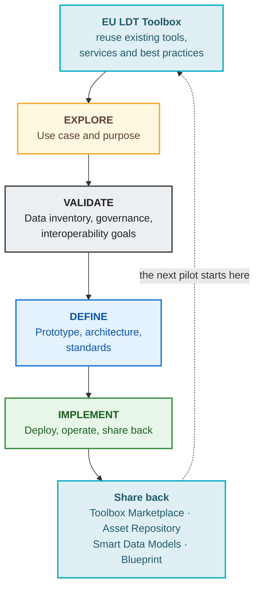
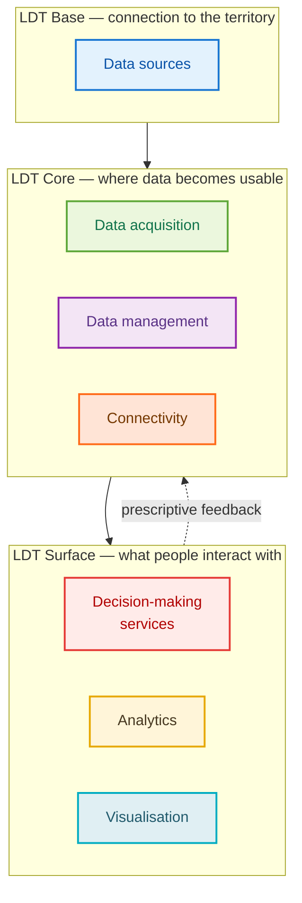
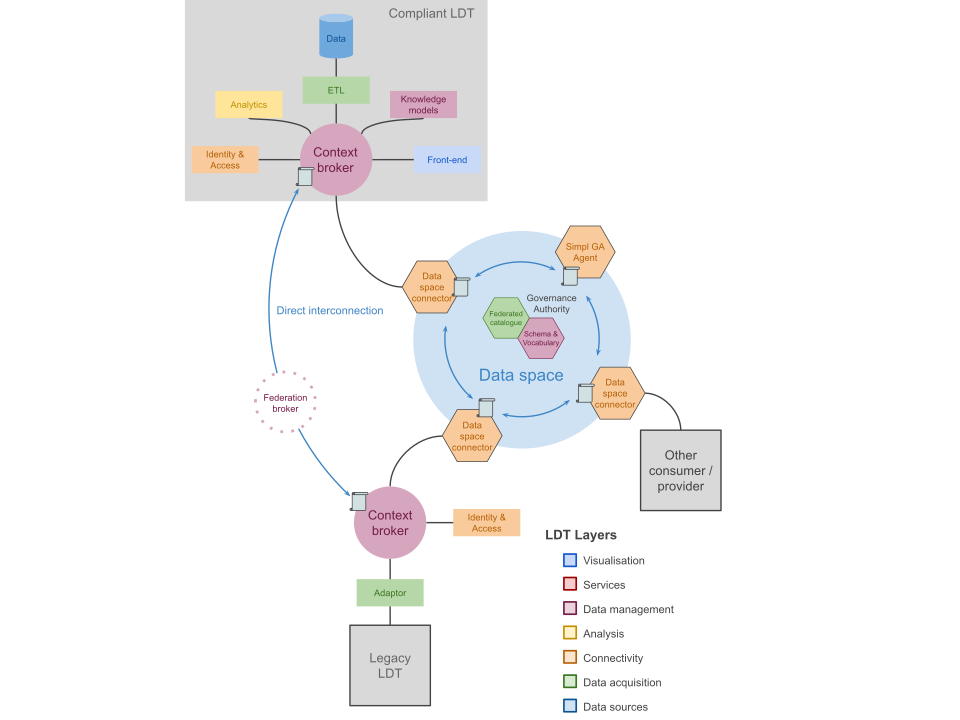
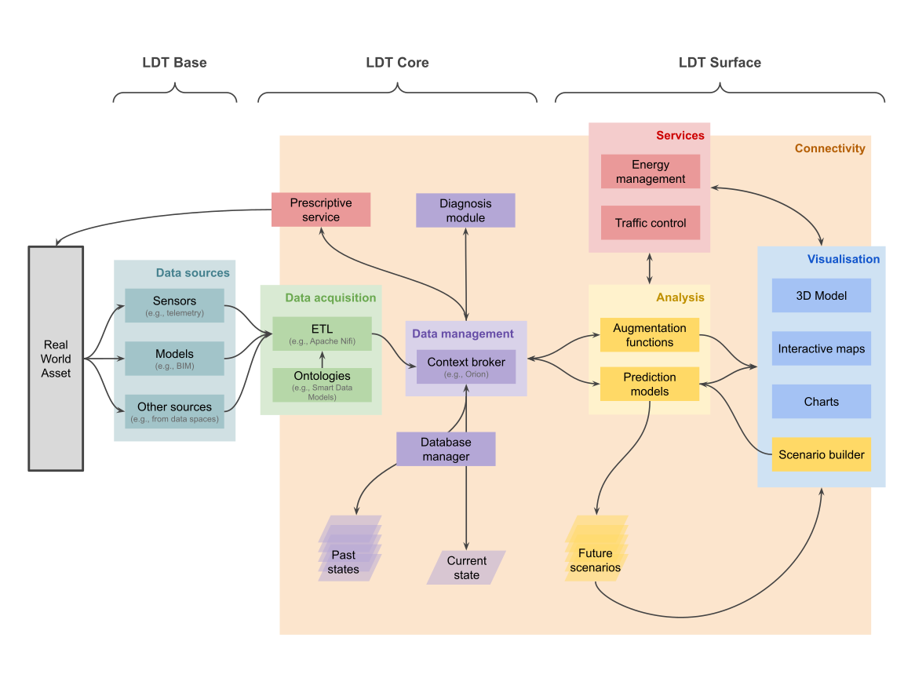
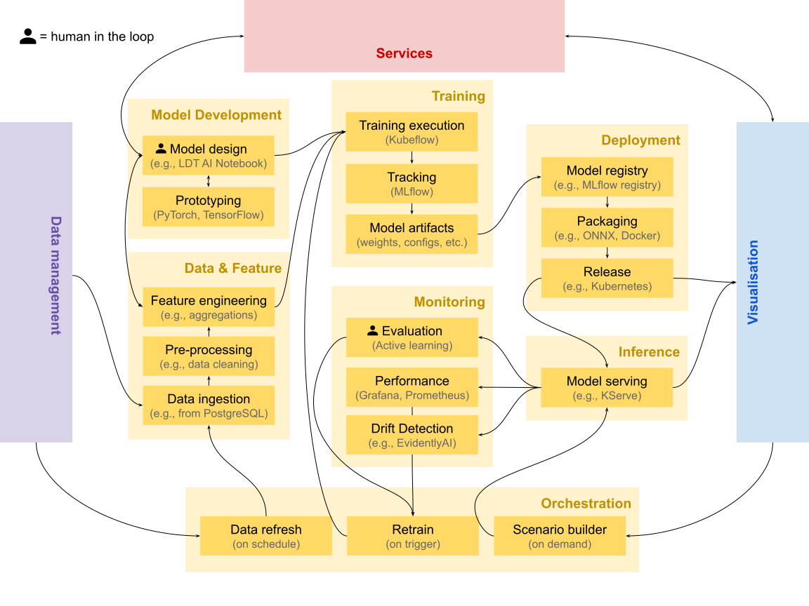

# Implementation Guidance

!!! warning "Draft for partner validation"
    This page is a **draft under review**. It is not listed in the site navigation and is
    excluded from search. It consolidates the LDT4SSC implementation guidance ahead of
    publication — comments and corrections are welcome before it goes live.

The open calls are closed and pilots are moving from *being selected* to *building*. This
page is the entry point for that phase: it brings the **methodology**, the **technical
resources**, and the **LDT Interoperability Blueprint** into a single route from a use case
on paper to a working, interoperable Local Digital Twin.

Where the [Resources for Pilots](../resources_content/index.md) section is a *library* — a
catalogue of standards, tools and frameworks to draw from — this page is the *assembly
instructions*: which pieces to pick up, in what order, and how they fit together for each
work strand.

## Start here

Three questions place you on the right path. They map to the three work strands, but they are
questions about **what you are building**, not about which call you applied to.

-   :material-lan-connect:{ .lg .middle } __I have LDTs. I need them to talk to each other.__

    You are working at the **Base** and **Core** levels: exposing what already exists through
    standard interfaces, and connecting it to other twins — directly, through a federation
    broker, or through a data space.

    [:octicons-arrow-right-24: WS1 architecture](#ws1-technical-interconnection) ·
    [WS1 workflow](workflows.md#ws1-interconnect-existing-ldts)

-   :material-cube-outline:{ .lg .middle } __We need a twin that does not exist yet.__

    You are building the **Core**: shared data acquisition, context management and analytics
    that several municipalities specify once and each instantiate locally, keeping sovereignty
    over their own data.

    [:octicons-arrow-right-24: WS2 architecture](#ws2-ldt-deployment) ·
    [WS2 workflow](workflows.md#ws2-deploy-a-new-ldt)

-   :material-brain:{ .lg .middle } __The twin works. It should now predict, explain or advise.__

    You are working at the **Surface**: AI services, simulation and immersive interfaces that
    consume an existing LDT and publish results back into it.

    [:octicons-arrow-right-24: WS3 architecture](#ws3-ai-based-services) ·
    [WS3 workflow](workflows.md#ws3-build-an-ai-based-service)

!!! info "The strands are cumulative, not exclusive"
    Interconnection, deployment and AI services stack on one another. A WS3 pilot still needs
    the Core a WS2 pilot builds; a WS2 pilot that wants to federate later will thank itself for
    following the WS1 interoperability choices from day one. Read across the tabs below rather
    than only your own.

---

## How the pieces fit together

Pilots have four bodies of support. They are not alternatives — each answers a different
question, and they are designed to be used together throughout the pilot's life. Three are
LDT4SSC's own; the fourth, the EU LDT Toolbox, is the wider European ecosystem this project
feeds into and draws from.

-   :material-compass-outline:{ .lg .middle } __The Methodology__

    *How do we organise ourselves?*

    Four phases — **EXPLORE → VALIDATE → DEFINE → IMPLEMENT** — and 15 self-contained
    workshops covering use-case definition, data governance, interoperability, business
    modelling and stakeholder onboarding.

    [:octicons-arrow-right-24: Methodology & workshops](../resources_content/methodology.md)

-   :material-toolbox-outline:{ .lg .middle } __The Technical Resources__

    *What do we build it with?*

    A filterable library of standards, protocols, frameworks and tools, classified by LDT
    layer, MIMs Plus, category and scope — plus the ISAQ self-assessment.

    [:octicons-arrow-right-24: Technical resource library](../resources_content/tech_resources.md)

-   :material-ruler-square-compass:{ .lg .middle } __The Interoperability Blueprint__

    *How should it be put together so it connects?*

    LDT building blocks, workflows, and reference architectures that make components
    reusable and twins interconnectable.

    [:octicons-arrow-right-24: LDT Interoperability Blueprint](../../blueprint/)

-   :material-package-variant:{ .lg .middle } __The EU LDT Toolbox__

    *What already exists that we can reuse — and where does our work go?*

    The European catalogue of LDT tools, services and best practices. Check it **before**
    building, and publish back to its Marketplace **after**.

    [:octicons-arrow-right-24: EU LDT Toolbox](https://interoperable-europe.ec.europa.eu/collection/ldttoolbox)

!!! info "The Blueprint is being written **with** pilots, not handed **to** them"
    The [LDT Interoperability Blueprint](../../blueprint/) is a **living, work-in-progress
    document, co-created with the pilots**. It is deliberately not finished: the building
    blocks, workflows and reference architectures in it are refined as pilots hit real
    obstacles and report back what worked.

    What this means for you, concretely:

    - **Treat it as guidance, not as a specification to certify against.** Where it is silent
      or underspecified, make a reasoned choice and document it.
    - **Your implementation decisions are inputs.** Gap analyses, workarounds, and "we tried X
      and it failed because Y" are exactly what the next revision needs.
    - **Report back through the [Pilot Journey](../journey/index.md)** and through your pilot
      deliverables. Those updates feed the Blueprint, the [Asset
      Repository](#obligations-and-checkpoints), and ultimately the EU LDT Toolbox.

### Finding your way around the Blueprint

The Blueprint is a single long specification. These are the entry points most relevant while
implementing — each links straight to the relevant section.

| If you are… | Go to |
|---|---|
| Getting oriented | [High-level overview of an LDT](https://spec.knows.idlab.ugent.be/ldt-interoperability-blueprint/latest/#high-level-overview-ldt) |
| Choosing what to build | [LDT building blocks](https://spec.knows.idlab.ugent.be/ldt-interoperability-blueprint/latest/#building-blocks) — [business & organisational](https://spec.knows.idlab.ugent.be/ldt-interoperability-blueprint/latest/#business-organisational-building-blocks) · [technical](https://spec.knows.idlab.ugent.be/ldt-interoperability-blueprint/latest/#technical-building-blocks) |
| Designing the architecture | [Reference architectures](https://spec.knows.idlab.ugent.be/ldt-interoperability-blueprint/latest/#reference-architectures) · [technical architecture](https://spec.knows.idlab.ugent.be/ldt-interoperability-blueprint/latest/#technical-architecture) |
| Adding a component to an existing twin | [Workflow: adding new Surface-level components](https://spec.knows.idlab.ugent.be/ldt-interoperability-blueprint/latest/#workflow-adding-new-slc-existing-ldt) |
| Making components discoverable | [Workflow: discovering compatible components](https://spec.knows.idlab.ugent.be/ldt-interoperability-blueprint/latest/#workflow-discover-slc-existing-ldt) |
| Picking standards | [Standards and protocols](https://spec.knows.idlab.ugent.be/ldt-interoperability-blueprint/latest/#standards-protocols) — [NGSI-LD](https://spec.knows.idlab.ugent.be/ldt-interoperability-blueprint/latest/#ngsild-based-systems) · [RDF](https://spec.knows.idlab.ugent.be/ldt-interoperability-blueprint/latest/#rdf-based-systems) |
| Checking MIMs alignment | [Alignment with MIMs Plus](https://spec.knows.idlab.ugent.be/ldt-interoperability-blueprint/latest/#alignment-mims) |
| Connecting to a data space | [Relationship between data spaces and LDTs](https://spec.knows.idlab.ugent.be/ldt-interoperability-blueprint/latest/#relationship-data-spaces) |

!!! info "Blueprint guidance per LDT layer"
    The Blueprint's [How to build an LDT](https://spec.knows.idlab.ugent.be/ldt-interoperability-blueprint/latest/#how-to-build-ldt) section is organised by the
    **same layers** used throughout this page and in the resource library — so once you know
    which layer you are working on, you can go straight to its guidance:

    [Data acquisition](https://spec.knows.idlab.ugent.be/ldt-interoperability-blueprint/latest/#how-to-build-data-acquisition) ·
    [Data management](https://spec.knows.idlab.ugent.be/ldt-interoperability-blueprint/latest/#how-to-build-data-management) ·
    [Connectivity](https://spec.knows.idlab.ugent.be/ldt-interoperability-blueprint/latest/#how-to-build-connectivity) ·
    [Analysis](https://spec.knows.idlab.ugent.be/ldt-interoperability-blueprint/latest/#how-to-build-analysis) ·
    [Decision-making](https://spec.knows.idlab.ugent.be/ldt-interoperability-blueprint/latest/#how-to-build-decision-making) ·
    [Visualisations](https://spec.knows.idlab.ugent.be/ldt-interoperability-blueprint/latest/#how-to-build-visualisations)

    It also splits guidance by methodology phase:
    [Explore & Validate](https://spec.knows.idlab.ugent.be/ldt-interoperability-blueprint/latest/#explore-validate) · [Define & Implement](https://spec.knows.idlab.ugent.be/ldt-interoperability-blueprint/latest/#define-implement).

!!! info "Coming to the Blueprint: maturity plateaus"
    A recurring question from pilots is *"where are we, and what is the next realistic step?"*
    A **maturity plateaus assessment** — successive plateaus a twin moves through, with the
    capabilities and interoperability features that define each — is planned for the Blueprint
    and is not yet published.

    Until then, use the [ISAQ](../resources_content/tech_resources.md#interoperability-self-assessment-questionnaire-isaq)
    for a point-in-time interoperability score, and the
    [five capabilities](#five-capabilities) below to describe how far your twin has matured.

<!-- ### A pilot's route, and the loop it closes

A pilot is not a straight line ending at deployment. Work **comes in** from the European
ecosystem at the start, and **goes back out** to it at the end — so the next pilot starts
further along than you did.

!!! info "Check the Toolbox before you build"
    Before committing to build a component, look for it in the
    [EU LDT Toolbox](https://interoperable-europe.ec.europa.eu/collection/ldttoolbox) catalogue and the
    [LDT4SSC Asset Repository](#sharing-back). Reusing or extending an existing component is
    almost always cheaper than starting from scratch — and it is what the openness principle
    asks of you in both directions.

The ISAQ sits across this route as a **checkpoint, not a gate**: run it early to find your
gaps, and again later to evidence progress — see
[Obligations and checkpoints](#obligations-and-checkpoints). -->

---

## What you are building

Before choosing tools, it helps to agree on what an LDT *is* in this project, and on the
vocabulary used throughout the architectures and workflows below.

!!! info "Working definition"
    A **Local (or Urban) Digital Twin** is a digital representation of physical assets, systems
    or processes in a defined local context (city, district, building, industry, port,
    airport). LDTs are based on **structured data models and contextualised data**. They
    leverage historical, near real-time or real-time data, and they enable **visualisation,
    analysis, simulation and reasoning services that support decision-making**.

    This is a *working* reference, intended to converge with the definition in
    **MIM8 – Local Digital Twins**. Cities already running mature twins on different
    architectures are not out of scope by default.

### Three levels

Components are organised into three levels that follow the data's path from the territory to
the people using it. Knowing which level you are working at tells you which architecture and
which workflow apply to you.

| Level | Layers it contains | Primary work strand |
|---|---|---|
| **Base** | Data sources | WS1 |
| **Core** | Data acquisition · Connectivity · Data management | WS2 |
| **Surface** | Analytics · Decision-making · Visualisation | WS3 |

The layer names above are the same ones used to classify every entry in the
[Technical Resource Library](../resources_content/tech_resources.md#technical-resource-library),
so you can filter the library by the layer you are currently working on.

!!! info "The Base/Core boundary is fluid in an interconnection"
    When two LDTs interconnect, **the Core of one twin may act as the Base of another**. This is
    why WS1 pilots should read the WS2 Core guidance too: what you expose becomes someone
    else's foundation.

### Five capabilities

Capability is the honest way to describe how far a twin has matured. Most pilots start
descriptive and add capabilities incrementally — you are not expected to reach prescriptive.

-   __1 · Descriptive__

    Current and past states of the real-world asset, static and dynamic. Augmentation
    functions pull stored data into live services and visualisations.

-   __2 · Predictive__

    Extends the descriptive twin with predictions of how the asset could evolve, using
    predictive models to envision future scenarios.

-   __3 · Prospective__

    Conducts *what-if* analyses, extending prediction across multiple possible futures to
    evaluate the consequences of an action.

-   __4 · Prescriptive__

    Suggests — or, in extreme cases, executes — actions on the real system to reach an
    objective. Requires safety, accountability and governance safeguards.

-   __5 · Diagnostic__

    Explains situations and alerts on deviations from expected conditions; evaluates what
    happened, especially when the real asset malfunctions.

### The functional scope

Not every component is essential. The **core** of an LDT is a contextual and semantic data
management system (typically a context broker) plus a knowledge meta-model. Everything else
is additive — and two components exist specifically to let twins interconnect.

!!! info "Which components are optional, and which unlock interconnection"
    - **Essential core:** contextual data management (context broker) + knowledge models.
    - **Additive:** ETL (integration), Identity (access rights), Visualisation and BI, Data
      Services, Code, Data.
    - **Not essential to a standalone twin, but required to interconnect:**
        - **Policy** — obligations and rights of data producer and user, verified via
          [ODRL](https://www.w3.org/TR/odrl-model/), managed through Eclipse Dataspace
          Components; SIMPL enables the process.
        - **Catalog** — standardised documentation of available data, enabling exposure and
          discovery of metadata.

---

## Reference architectures

These are **possibilities, not prescriptions**. Pilots run many different internal
implementations, including proprietary ones, and these architectures are deliberately agnostic
to what sits inside an existing twin. They show how the principles, definitions and resources
in this Hub combine into something buildable.

!!! info "Many meta-architectures for LDTs exist and are still emerging"
    These reflect the current state of the art. For an up-to-date overview, refer to
    [MIMs Plus 8 on Local Digital Twins](https://mims.oascities.org/local-digital-twins)
    alongside the Blueprint's own
    [reference architectures](https://spec.knows.idlab.ugent.be/ldt-interoperability-blueprint/latest/#reference-architectures), which go a level deeper into the
    [technical architecture](https://spec.knows.idlab.ugent.be/ldt-interoperability-blueprint/latest/#technical-architecture) and the
    [artefacts exchanged between components](https://spec.knows.idlab.ugent.be/ldt-interoperability-blueprint/latest/#artefacts).

=== "WS1 · Technical interconnection"

    

    **The question:** how do two or more existing twins share data without either of them
    rebuilding its internals?

    { width="100%" }

    **How it works**

    1. **Adapt before exposing.** A transformation layer (adaptor) maps the legacy twin's data
       to interoperable standards *prior to exposure*, without altering the local, sovereign
       storage format inside the organisation.
    2. **Expose through a broker plus a security component.** The context broker is pivotal: as
       well as orchestrating the twin, it acts as a first compliance check. NGSI-LD brokers
       natively verify syntactic compliance with the NGSI-LD information model — semantic
       consistency, data quality and ontological alignment still need complementary governance.
    3. **Connect directly** where twins belong to the same organisation or neighbouring
       departments: two context brokers can intercommunicate, share a broker within one
       security layer, or use the **NGSI-LD federation architecture** (§4.3.4 of ETSI GS CIM
       009), where a federation broker aggregates distant information and exposes it as if it
       came from a central broker, based on sharing rules registered in a Context Registry.
    4. **Or connect via a data space**, deploying a data space connector that manages security,
       access, contracts and policy. **Using a SIMPL Governance Authority Agent is a
       requirement in WS1** — it defines the vocabulary and schema and maintains a compliant
       shared catalogue.

    **Key components**

    | Component | Role |
    |---|---|
    | Adaptor | Maps legacy data to interoperable standards before exposure |
    | Context broker | Orchestrates entities; first check on syntactic compliance |
    | Identity & access | Authentication, authorisation, token-based access control |
    | Federation broker | Aggregates distant brokers, exposed as if central |
    | Data space connector | Security, access, contracts and policy enforcement |
    | SIMPL GA Agent | Vocabulary, schema and federated catalogue — **required in WS1** |

    ??? info "SIMPL-Open technology stack (as currently deployed)"

        | Component | Technology | Capability |
        |---|---|---|
        | Self-Descriptions (SD) | SD (GX-Trustframework) | Metadata description |
        | SD Creator | XFSC SD Tooling | Metadata description |
        | Data Space Catalogue | XFSC Federated Catalogue | Data discovery |
        | Signer Service | XFSC Signer | Signature |
        | Connector | EDC | Data exchange |
        | Infrastructure Provisioning | Crossplane | Infrastructure provisioning |
        | Authentication | Keycloak | Authentication provider |
        | Identity Provider | EJBCA | Identity provider |
        | Authorisation | Spring Cloud Gateway | Authorisation |

    !!! info "What 'done' looks like"
        Interconnected entities share data and resources in a trustworthy, interoperable way —
        cataloguing, policies, configuration, identity and access management, and contracting
        all handled in the data space sphere. Twins act as **both consumers and providers**.

=== "WS2 · LDT deployment"

    

    **The question:** what do we actually have to build, and in what order, to stand up a twin
    that does not exist yet?

    { width="100%" }

    **How it works**

    1. **The Base captures the territory.** Sensors provide telemetry, models such as BIM
       describe built assets, and external sources — including data spaces — supply the rest.
    2. **The Core makes data usable.** Data acquisition components (ETL pipelines, semantic
       alignment through ontologies like Smart Data Models) transform and validate incoming
       data before a context broker manages it.
    3. **The broker is the central integration point**, maintaining the current state of all
       entities, while past states remain reachable through temporal APIs or dedicated
       time-series storage.
    4. **The Surface delivers value** through Analysis (augmentation functions and prediction
       models generating future scenarios), Services (domain applications such as energy
       management or traffic control), and Visualisation (3D models, interactive maps, charts,
       scenario builders).

    **Key components**

    | Component | Role |
    |---|---|
    | Data sources | Sensors, BIM models, external and administrative sources |
    | ETL | Transforms and validates incoming data |
    | Ontologies | Semantic alignment (e.g. Smart Data Models) |
    | Context broker | Central integration point; current state of all entities |
    | Database manager | Past states for historical analysis |
    | Analysis | Augmentation functions and prediction models |
    | Services & Visualisation | Domain applications and user-facing interfaces |

    !!! warning "The architecture is bidirectional"
        Prescriptive services and diagnosis modules feed **back** into the Core, enabling
        improvement loops where AI-driven recommendations inform decision-making, operational
        processes, or — where appropriate and properly governed — certain automated actions on
        real-world assets, in compliance with safety, accountability and governance
        requirements.

    !!! info "What 'done' looks like"
        Each municipality runs its own instance of a jointly specified Core, fed by its own
        Base-level data, retaining ownership of its data and control over configuration — while
        benefiting from shared development effort.

=== "WS3 · AI-based services"

    

    **The question:** how do we develop, deploy and keep alive an AI service on top of a twin?

    { width="100%" }

    **How it works**

    1. **Data & Feature draws from the Core.** It fetches historical and real-time data from the
       data management layer, pre-processes it (cleaning, transformation) and engineers features
       such as spatial joins and temporal aggregations.
    2. **Model Development and Training.** Model definitions and architectures are prototyped,
       then trained on distributed infrastructure with every run tracked — hyperparameters,
       metrics, dataset versions — producing model artifacts.
    3. **Deployment and Inference.** Validated models are registered, packaged to portable
       formats and released; serving endpoints handle prediction requests and **publish results
       back to the LDT** as standardised (e.g. NGSI-LD) entities.
    4. **Monitoring closes the loop.** Performance tracking and drift detection signal the
       Orchestration layer, which manages data refresh on schedule, retraining on trigger, and
       on-demand scenario building for user-driven requests.

    !!! warning "This is not a linear pipeline"
        AI development is iterative and cyclical: insights from deployment inform data
        collection, model failures trigger re-examination of features, user feedback reshapes
        problem framing, and drift detection prompts recalibration. Feedback loops connect
        Inference back to upstream domains via monitoring and retraining.

    **The six domains**

    | Domain | What it does |
    |---|---|
    | **Data & Feature** | Ingests from the Core; cleans, transforms, engineers features; generates synthetic data when needed |
    | **Model Development** | Model definitions — theoretical, agent-based or data-driven — plus architectures and validation strategies |
    | **Training** | Executes training runs, tracks experiments, produces artifacts (weights, configs, metrics) |
    | **Deployment** | Registers validated models, packages to portable formats, releases to production |
    | **Inference** | Serving endpoints handle requests and publish results back to the LDT |
    | **Monitoring** | Tracks performance, detects data and concept drift, triggers retraining |

    **Orchestration** is a cross-cutting domain managing three cycles: **data refresh** on
    schedule, **retrain** on trigger (drift detected, or specialist evaluation via active
    learning), and **scenario builder** on demand for user-driven inference requests.

    !!! info "Two concerns permeate every domain"
        - **Responsible AI** — explainability, fairness assessment, uncertainty quantification —
          ensures services meet European trustworthiness requirements.
        - **Governance and Security** — access control, approval workflows, data space
          integration via EDC and ODRL — ensures services operate within appropriate policy
          frameworks.

    !!! info "What 'done' looks like"
        The **Analysis layer of the LDT Surface** becomes the integration point between MLOps
        infrastructure and the wider LDT ecosystem: AI services consume current and past states
        from the real-world asset and publish future scenarios feeding visualisation, services
        and citizen-facing applications.

---

## Implementation workflows

Three worked examples take each work strand from an existing situation to a working result —
the standards and tools above, arranged into a sequence. They live on their own page because
each runs to several steps.

-   :material-lan-connect:{ .lg .middle } __WS1 · Interconnect existing LDTs__

    Expose a legacy twin through standard interfaces and join a data space — 4 steps.

    [:octicons-arrow-right-24: WS1 workflow](workflows.md#ws1-interconnect-existing-ldts)

-   :material-cube-outline:{ .lg .middle } __WS2 · Deploy a new LDT__

    Specify once, instantiate locally, keep sovereignty over your own data — 9 steps.

    [:octicons-arrow-right-24: WS2 workflow](workflows.md#ws2-deploy-a-new-ldt)

-   :material-brain:{ .lg .middle } __WS3 · Build an AI-based service__

    From LDT data to a validated, published AI service — 9 steps.

    [:octicons-arrow-right-24: WS3 workflow](workflows.md#ws3-build-an-ai-based-service)

[:octicons-arrow-right-24: All implementation workflows](workflows.md){ .md-button .md-button--primary }

---

## Learning from real deployments

Six deployments that put these concepts into practice. They are not LDT4SSC pilots — they are
prior and parallel work worth learning from, including where they fall short of the
interoperability this project asks for. Each is tagged with the strand it best illustrates.

| Deployment | Illustrates | In one line |
|---|---|---|
| **Perugia (IT)** | WS1 · WS2 | An interoperable urban platform on the FIWARE stack, with inter-municipal data governance |
| **Zurich (CH)** | WS2 · WS3 | A dynamic 3D twin grown from a 2011 city model into an operational planning system |
| **Differdange (LU)** | WS2 | EV charging balanced against renewable generation — mid-migration to open standards |
| **Antibes (FR)** | WS2 · WS3 | Indoor air quality across a school, surfaced through a 3D twin of the territory |
| **Kiel (DE)** | WS3 | Immersive heritage and ocean literacy in the SENSE CitiVerse pilot |
| **Cartagena (ES)** | WS3 | Real-time mobility and environmental indicators in a photorealistic 3D control room |

Expand any deployment below for the full account — the stack used, what it achieved, and where
it still falls short of the interoperability this project asks for.

??? example "Perugia (IT) — an interoperable urban platform"

    Perugia harmonised its data using the **FIWARE** stack, specifically a solution called
    WiseTown. The project integrated the city's software infrastructure, managing large amounts
    of data from different sources — geographical information systems, satellite images, IoT
    sensors. [**Smart Data Models**](https://github.com/smart-data-models) allowed semantic interoperability, while a **context broker**
    integrated the orchestration onto NGSI-LD standards.

    **The stack:** Smart Data Models, [**Orion-LD**](https://github.com/FIWARE/context.Orion-LD/tree/develop/doc/manuals-ld) as messaging and context information manager,
    FIWARE **Keyrock** for security infrastructure, and the FIWARE **IDAS** solution for IoT
    agents.

    **Use cases deployed:** mobility and parking (real-time traffic and parking availability);
    environment and quality of life (air pollution, noise, public lighting); green space
    management; energy optimisation (public lighting scenarios, renewable integration); and
    citizen participation (mobile apps and crowd-planning tools for residents to report
    problems and monitor resolution).

    **Why it matters:** Perugia's ability, as a **medium-sized city**, to mobilise interoperable
    infrastructure and implement inter-municipal data governance. It demonstrates that
    interoperability "by design", combined with shared data governance, can drive innovation for
    local authorities beyond the major cities.

    [Video presentation](https://www.youtube.com/watch?v=ZtXkcPQSGiU) ·
    [FIWARE ecosystem write-up](https://www.fiware.org/2021/11/15/perugias-digital-transition-to-smart-city-powered-by-fiware-technology/)

??? example "Zurich (CH) — a dynamic 3D twin of the built environment"

    Facing growth to 520,000 residents by 2040, Zurich launched a dynamic 3D spatial model to
    support evidence-based decision-making, integrating real-time data, 3D models and analytical
    tools to simulate climate impacts, densification and mobility.

    The twin evolved from Zurich's **3D City Model** (2011, managed by the GIS department,
    integrated by ESRI), encompassing topography, buildings, bridges and vegetation at various
    levels of detail. These datasets became the base for linking cadastral, environmental and
    planning information under a governance framework aligned with Switzerland's Federal Act on
    Geoinformation (GeoIG). Data is public via the city's Geoportal, with interactive
    visualisation through **Zurich Virtuell**.

    **Applications:** the Municipal Development Plan (current, allowed and scenario development);
    urban climate analysis (airflow modelling, heat mitigation); architectural competitions with
    AR-assisted jury assessment; and participatory initiatives such as "Minecraft Zurich",
    lowering barriers to political participation.

    !!! warning "Read this one critically"
        Zurich shows how a data platform can mature into a full digital twin with an operational
        decision-support system. **However**, LDT4SSC envisions communities adopting an *open*
        architecture to guarantee interconnection and interoperability. Proprietary solutions
        such as the one adopted here would need adapting to the interoperable standards and
        specifications set out in this guidance.

??? example "Differdange (LU) — clean energy and mobility"

    Differdange pursues net-zero carbon emissions through renewable energy initiatives. LIST,
    with the city's experts in the CitCom.ai project, developed an LDT integrating **electric
    vehicle infrastructure and renewable energy generation** — leveraging information on charging
    points, buildings and solar panels, because understanding the balance between renewable
    production and charging-station demand is essential to the city's sustainability goals.

    The implementation includes data collection and telemetry emulators, spatio-temporal and
    graph databases, DT cloud solutions, and interactive maps and dashboards. Analytical models
    both produce synthetic telemetry and predict telemetry under simulation parameters.

    **The interoperability journey — useful precisely because it is unfinished:** the team is
    producing a **gap analysis** to assess the current implementation's interoperability. First
    step is adopting an NGSI-LD-compliant context broker (Stellio, Orion-LD or Scorpio). Second
    is adopting domain-specific ontologies from **Smart Data Models** — the Buildings model from
    Smart Cities, plus Photovoltaic Device and Photovoltaic Measurement from Smart Energy.

    Notably, their effort is **not** to add a virtualisation layer to transform data, but to
    overhaul the data structure itself — a different trade-off from the WS1 workflow above.

??? example "Antibes (FR) — an indoor descriptive LDT with 3D implementation"

    In enclosed spaces, indoor air quality is greatly affected by CO₂, which affects comfort and
    health; regulations may require ventilation assessment and pollutant control measures.

    Antibes Town Hall and EGM equipped teaching and living spaces at the Jean Moulin School with
    **30 Nexelec Carbon sensors** across 14 primary classrooms, 6 nursery classrooms, 1 activity
    room, 2 dormitories and a large dining hall, continuously measuring CO₂, temperature and
    relative humidity.

    Sensors connect to the **Orange LoRaWAN** network; data is centralised on an EGM TWIN·PICKS
    platform (FIWARE architecture with [**Stellio**](https://stellio.readthedocs.io/en/latest/) context broker), where the school air
    confinement index (**ICONE**) is calculated from continuous CO₂ measurement over a school
    week at 10-minute intervals, exclusively for periods when the room is occupied.

    The city fed the ICONE index into its existing 3D representation of the territory: temporal
    data is retrieved **directly from the NGSI-LD API** by the 3D visualisation tools Terra
    Explorer and Cesium — a clean illustration of a Surface component consuming a standard Core
    interface.

??? example "Kiel (DE) — immersive heritage and ocean literacy"

    Kiel is a pilot in **SENSE** (Strengthening Cities and Enhancing Neighbourhood Sense of
    Belonging), creating interconnected virtual worlds mirroring real cities, using EU data
    infrastructure and interoperability standards to develop CitiVerse use cases.

    **Two scenarios:** *Hidden World* reveals intangible history — such as pre-war architecture
    destroyed during WWII — through spatialised storytelling embedded in a 3D twin. *SEALEVEL*
    provides a seaward extension of the digital city, connecting curated information on marine
    ecosystems and water quality with the land–sea interface of the Kiel Fjord.

    **Technically:** a frontend User Application, a Scenario Service Layer, and a Data &
    Knowledge Layer connected to the SENSE Data Space. A structured **Narrative Tour Model**
    orchestrates chapter progression and triggers automated fly-to actions and viewpoint framing
    in the 3D environment. Content is delivered via JSON-based narrative definitions binding
    descriptive text and archive media to georeferenced **OGC POI**-aligned points of interest.
    Parking sensor data is exposed through a **FIWARE Orion Context Broker** API with NGSIv2 and
    FIWARE Smart Data Models. A Metocean and water-quality indicator model translates
    hydrological observations into interpretable status summaries and historical comparisons.

??? example "Cartagena (ES) — smart mobility and urban cohesion"

    Also a **SENSE** CitiVerse pilot, Cartagena focuses on **Smart Urban Mobility** and **Public
    Space, Environment and Quality of Life**.

    The mobility scenario integrates real-time traffic monitoring with environmental indicators,
    letting users visualise how individual travel choices affect collective outcomes like air
    quality. The second scenario extends this into an **urban cohesion lens**, where planners and
    residents explore how socio-economic indicators (age structure, employment, income) intersect
    with environmental stressors like noise and heat — identifying **vulnerability hotspots**
    where limited green space and high pollution overlap with low social resilience, justifying
    more equitable interventions.

    **Technically:** a high-resolution 3D City Model rendered with **Unreal Engine** and **Cesium
    3D Tiles**. The data layer uses a FIWARE architecture with the **Orion Context Broker**
    ingesting live streams from 13 traffic flow sensors, 25 crowd flow sensors, 26 air quality
    sensors and 20 parking occupancy sensors, modelled per NGSIv2 and FIWARE Smart Data Models. A
    graph-based street network model supports multi-criteria optimisation (Dijkstra/A\* family)
    weighing travel time against environmental exposure and regulatory constraints.

    For citizens, an interactive 3D mobility assistant compares routes on travel time,
    reliability, emissions and Low-Emission Zone compliance. For professionals, a virtual
    control-room offers what-if simulations for temporary events and before/after comparisons to
    evaluate mobility plans.

!!! info "See LDT4SSC pilots as they build"
    The examples above are external references. To follow **our own pilots** — what they are
    building, the obstacles they hit and the assets they publish — see the
    [Pilot Journey](../journey/index.md) and the
    [aggregated pilot updates](../journey/feed.md).

---

## Obligations and checkpoints

Most of this page is guidance you can adapt. This section is not — these are commitments that
apply to pilots across all three work strands.

!!! pilot "Interoperability Self-Assessment is a condition for payment"
    Awarded pilots across all three Work Strands must complete the **Interoperability
    Self-Assessment Questionnaire (ISAQ)** during **months 1–2** of their project, and again
    during the **second reporting period**. It is a predefined Pilot Deliverable.

    **Achieving a score above three in the final assessment is a condition for payment.** Pilots
    must share the completed Excel file including all sheets.

    [:octicons-arrow-right-24: Get the ISAQ](../resources_content/tech_resources.md#interoperability-self-assessment-questionnaire-isaq)

### Throughout the pilot

- **Engage with at least five foundational MIMs Plus** — MIM0 (Accessing Data), MIM1
  (Interlinking Data), MIM2 (Representing Data), MIM3 (Sharing Data), MIM6 (Securing Data) —
  and use a Linked Data ontology (MIM1) for semantic consistency.
- **Follow the methodology phases:** EXPLORE → VALIDATE → DEFINE → IMPLEMENT, with a workplan
  structured around pilot deliverables PD1–PD5.
- **Publish open data models** in open repositories under open licences.
- **Justify proprietary components** and provide a plan towards an open-source equivalent.
- **Document continuously** for this Knowledge Hub — see the
  [Pilot Journey](../journey/index.md) for how updates are published.

### Sharing back

The project's openness principle is concrete and runs in both directions: you draw on the
European ecosystem at the start, and components developed in your pilot return to it at the
end. This is the step that makes the next pilot cheaper than yours.

**Where things go**

| Destination | What belongs there |
|---|---|
| [**EU LDT Toolbox** Marketplace](https://interoperable-europe.ec.europa.eu/collection/ldttoolbox) | Reusable tools and services other European cities can adopt |
| **LDT4SSC Asset Repository** | Pilot-produced components, configurations and deployment recipes |
| [**Smart Data Models**](https://github.com/smart-data-models) | New or extended entity models (e.g. `PredictedTrafficFlow`) |
| [**Interoperability Blueprint**](../../blueprint/) | Gap analyses, obstacles hit, patterns that worked |
| [**Knowledge Hub**](../journey/index.md) | Progress updates, lessons learned, published assets |

**How to package**

- Package components as **containers** with Helm charts, API specifications and sample
  configuration for different city sizes.
- Include the documentation that makes reuse possible: data requirements, deployment
  procedures, governance arrangements and — for AI services — model cards.
- Ensure shared components are compatible with [**SIMPL-Open**](https://code.europa.eu/simpl/simpl-open/documentation/user-manual)'s
  architecture and the EU LDT Toolbox.
- Publish under an **open licence**; justify any proprietary component and provide a route to an
  open-source equivalent.

!!! info "Package as you go, not at the end"
    Pilots that leave packaging to the final months consistently under-deliver on it. Treat the
    container, the API spec and the README as part of each component's definition of done — the
    [WS2](workflows.md#ws2-deploy-a-new-ldt) and [WS3](workflows.md#ws3-build-an-ai-based-service) workflows both build this in from step 1.

### Where to go next

-   :material-compass-outline:{ .lg .middle } __Run a workshop__

    Fifteen self-contained workshops across the four phases.

    [:octicons-arrow-right-24: Methodology](../resources_content/methodology.md)

-   :material-toolbox-outline:{ .lg .middle } __Find a tool__

    Filter the library by layer, MIM, category or scope.

    [:octicons-arrow-right-24: Technical resources](../resources_content/tech_resources.md)

-   :material-scale-balance:{ .lg .middle } __Governance, legal, business model__

    Impact assessment, cost-benefit analysis, legal and AI guidance.

    [:octicons-arrow-right-24: Non-technical resources](../resources_content/non_tech_resources.md)

-   :material-ruler-square-compass:{ .lg .middle } __Shape the Blueprint__

    Building blocks, workflows and reference architectures — co-created with pilots.

    [:octicons-arrow-right-24: Interoperability Blueprint](../../blueprint/)

-   :material-package-variant:{ .lg .middle } __Reuse and publish__

    The European catalogue of LDT tools and services — check it before building, publish to it
    after.

    [:octicons-arrow-right-24: EU LDT Toolbox](https://interoperable-europe.ec.europa.eu/collection/ldttoolbox)

---

!!! info "Feedback on this page"
    This draft consolidates guidance that was previously spread across the technical resources,
    the methodology and internal deliverables — in particular the reference architectures and
    implementation workflows, which were not publicly available before. If something is missing,
    wrong, or reads as more prescriptive than it should, please flag it before publication.
