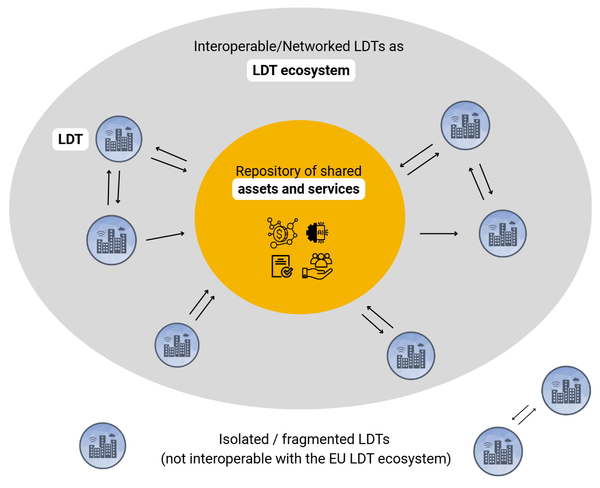
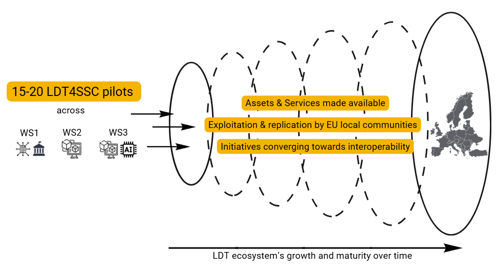
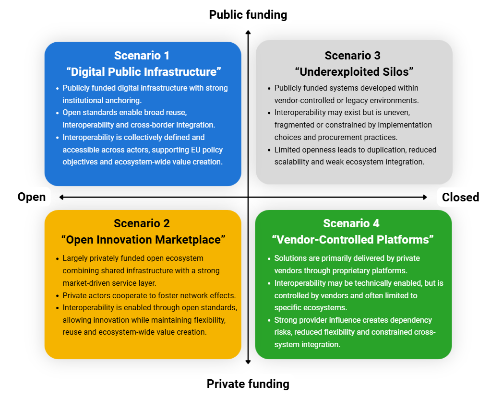
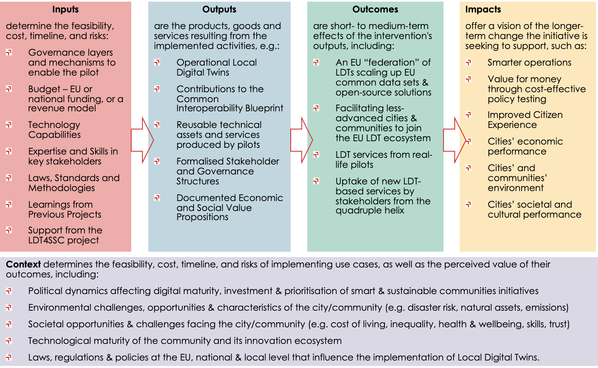

# Strategy & Sustainability

Climate adaptation, mobility, energy optimisation and environmental resilience do not stop at
municipal borders. Local Digital Twins could help communities tackle them together — but
despite significant European investment, most LDTs remain isolated, and the landscape still
lacks sustainable operational and governance models.

This section sets out what LDT4SSC is doing about that: the project's **mission and vision**,
and the **Framework and Strategy for Growth and Sustainability** that analyses how a European
LDT ecosystem can be grown and sustained.

-   :material-leaf:{ .lg .middle } __Sustainability__

    Six dimensions — political, economic, social, technological, legal, environmental — and
    the drivers behind each.

    [:octicons-arrow-right-24: On this page](#dimensions-of-sustainability)

-   :material-chart-box-outline:{ .lg .middle } __Ecosystem diagnostics__

    Strengths, weaknesses, opportunities and threats for the ecosystem and for LDT4SSC's own
    assets.

    [:octicons-arrow-right-24: Diagnostics](diagnostics.md)

-   :material-cash-multiple:{ .lg .middle } __Value & funding__

    Value creation and capture, seven open-source funding models, and the validation and
    certification landscape.

    [:octicons-arrow-right-24: Value & funding](value.md)

-   :material-flag-checkered:{ .lg .middle } __Strategic priorities__

    Eighteen capabilities and five priorities, with recommendations for pilots, for LDT4SSC and
    for the wider ecosystem.

    [:octicons-arrow-right-24: Priorities](priorities.md)

---

## Mission, vision & values

LDT4SSC is a [Digital Europe Programme](https://digital-strategy.ec.europa.eu/en/activities/digital-programme)
project contributing to two Commission goals: improving the digitalisation of Europe, and
improving citizens' lives through sustainability and environmental protection.

It builds on and integrates outputs from related EU-funded work — the
[European data space for smart communities (DS4SSCC)](https://www.ds4sscc.eu/), the
[EU LDT Toolbox](https://interoperable-europe.ec.europa.eu/collection/ldttoolbox),
[Living-in.EU](https://living-in.eu/), [CitCom.ai](https://citcomtef.eu/) and
[SIMPL](https://simpl-programme.ec.europa.eu/). These initiatives are described in the
[Smart Communities Ecosystem](../communities_content/index.md) section.

!!! info "Mission"
    To build a scalable and interoperable ecosystem of Local Digital Twins to empower European
    local communities with opportunities to share and reuse (real-time) data, advanced AI
    capabilities, simulation and federated services. These assets and services foster
    data-driven decision-making, improved public value creation and resilient, equitable urban
    and community development.

**Vision** — a resilient, inclusive and interconnected European LDT ecosystem, where:

- LDTs operate as **core public digital infrastructure**;
- stakeholders from local communities **share data, services and other assets seamlessly**;
- integration with the [EU LDT Toolbox](https://interoperable-europe.ec.europa.eu/collection/ldttoolbox)
  fosters replication of LDT4SSC assets and supports scalability;
- [SIMPL](https://simpl-programme.ec.europa.eu/) and the
  [LDT CitiVERSE EDIC](https://ldtcitiverse-edic.eu/) offer opportunities for long-term
  federation;
- AI-powered LDT services support the EU's green and digital transition, strengthening Europe's
  competitiveness and digital sovereignty.

**Values**

| Value | Scope |
|---|---|
| **Sustainability through innovation and openness** | Economic, environmental and social sustainability through open standards, data-sharing and fair competition in AI and LDT-based services |
| **Inclusiveness, collaboration & co-creation** | Communities of all sizes and maturity levels, through cross-border, cross-sectoral quadruple-helix partnerships |
| **Resilience & competitiveness** | European digital sovereignty, reduced reliance on foreign technologies, quality of life |
| **Trust & ethics** | Privacy, security, EU regulatory compliance, ethical AI that is economically viable and societally sustainable |

## The Framework and Strategy

Isolation carries a cost: without interoperability there is no replication, no network
effects, and little collaboration between communities facing the same problems.

The **Framework and Strategy for Growth and Sustainability** is the project's plan for growing
and sustaining a European LDT ecosystem, defined as an *open and interoperable collaboration
framework for LDT initiatives, used and sustained by multi-stakeholder communities to address
common local and regional challenges*.

It serves three purposes:

1. **Guiding pilots** in designing sustainable LDT implementations and sharing what they build;
2. **Aligning LDT4SSC activities and assets** towards long-term ecosystem development;
3. **Informing external stakeholders and policymakers** on the conditions a sustainable European
   LDT ecosystem requires.

### The ecosystem in question

An LDT ecosystem is what emerges when individual twins become interoperable and draw on a shared
repository of assets and services. Twins that stay isolated remain outside it.

{ width="88%" }

LDT4SSC's role is to grow that ecosystem from 15–20 pilots into something EU-wide, through
assets and services that other communities can take up.

{ width="100%" }

---

## Dimensions of sustainability

In data-intensive, multi-stakeholder community systems, **sustainability goes beyond technical
and financial upkeep**. It covers the conditions that let value reach all stakeholders, the
integration of LDTs into governance and service delivery, societal acceptance, and alignment
with public values and legal frameworks.

Drawing on the PESTLE framework, the strategy sets out six dimensions, each with drivers that
must be sufficiently in place for an LDT to function, generate value and keep evolving.

!!! info "Stakeholder rankings"
    At the February 2026 Stakeholder Forum, **social and civic sustainability was ranked the
    most important dimension by 78% of respondents**. Within individual dimensions, political
    leadership (60%) and clear value propositions (58%) led.

    Rankings come from 9–18 responses among 70 attendees, so they indicate direction rather
    than settled weighting. They will be refined through analysis of the pilots.

=== "Political"

    The capacity of governance systems at local, national and EU levels to provide stable
    support, coherent policies and enabling frameworks.

    - **Political leadership** through resource allocation and enabling frameworks — shaping how
      priorities become regulation, institutional arrangements and investment decisions.
      *Ranked first by 60% of respondents.*
    - **Sustained buy-in and multi-level support**, securing initial funding and institutional
      backing for long-term upkeep, with cross-departmental coordination.
    - **Policy coherence across political cycles** — embedding LDTs into statutory planning and
      multi-annual funding reduces exposure to political turnover. Alignment with the
      [Interoperable Europe Act](https://eur-lex.europa.eu/eli/reg/2024/903/oj/eng),
      [Green Deal](https://commission.europa.eu/strategy-and-policy/priorities-2019-2024/european-green-deal_en)
      and [Digital Decade](https://digital-strategy.ec.europa.eu/en/policies/europes-digital-decade)
      helps.

=== "Economic"

    Financial viability, resource mobilisation, the logic for value creation and capture, and
    the organisational capacity to operate, adapt and scale.

    - **Clear value propositions with measurable public and economic outcomes**, rather than
      abstract innovation goals. *Ranked first by 58% of respondents.*
    - **Market intelligence and stakeholder engagement** (25%).
    - **Internal capacity and integration into organisational workflows** (17%), reducing
      dependency on external providers.
    - **Cost-benefit planning over the full lifecycle** — initial deployments are often
      grant-funded while long-term operational costs are underestimated. See EU guidance on
      [life-cycle costing](https://green-forum.ec.europa.eu/green-business/green-public-procurement/life-cycle-costing_en).
    - **Funding continuity** through diversified financing. See
      [value and funding models](value.md#funding-models-for-open-source-initiatives).

=== "Social & civic"

    How far LDTs reflect community needs, inclusion, legitimacy, trust and equitable
    participation — and avoid reinforcing socio-economic or socio-technical divides.

    **Ranked the most important dimension overall by 78% of Stakeholder Forum respondents.**
    Covers societal acceptance, social well-being and cohesion, and inclusive engagement.

    Citizen co-production is identified as a current weakness of the ecosystem — see
    [diagnostics](diagnostics.md#swot-analysis).

=== "Technological & data"

    The technical foundations keeping an LDT operable and connectable: open standards, modular
    architectures, data quality and provenance, and avoidance of vendor lock-in.

    Anchored in [MIMs Plus](https://living-in.eu/group/7/commitments/mims-plus-version-8-2025),
    [NGSI-LD](https://ngsi-ld.org/) and
    [FAIR principles](https://www.openscience.eu/article/infrastructure/guide-fair-principles).
    The [LDT Interoperability Blueprint](../blueprint/), the
    [technical resources](../resources_content/tech_resources.md) and the
    [implementation guidance](../guidance_content/implementation.md) do most of the work here.

=== "Legal"

    Frameworks enabling data access and sharing — including across jurisdictions — and the
    capacity to adapt to regulatory change, embedding compliance and ethics by design.

    In scope: the [AI Act](https://eur-lex.europa.eu/eli/reg/2024/1689/oj/eng),
    [Data Act](https://digital-strategy.ec.europa.eu/en/policies/data-act),
    [Data Governance Act](https://eur-lex.europa.eu/eli/reg/2022/868/oj),
    [Cyber Resilience Act](https://digital-strategy.ec.europa.eu/en/policies/cyber-resilience-act),
    [NIS2 Directive](https://digital-strategy.ec.europa.eu/en/policies/nis2-directive) and
    eIDAS 2.0.

    *Regulatory compliance by design* was ranked the leading legal consideration.

=== "Environmental"

    The footprint of LDT infrastructure itself, and the capacity to build responsible digital
    practices — including [eco-design](https://www.arcep.fr/uploads/tx_gspublication/general_policy_framework_for_the_ecodesign_of_digital_services_version_2024.pdf) and ongoing monitoring — into development and operations.

    See the
    [General Policy Framework for the Ecodesign of Digital Services](https://www.arcep.fr/uploads/tx_gspublication/general_policy_framework_for_the_ecodesign_of_digital_services_version_2024.pdf).

---

## Four possible futures

To test the strategy against uncertainty, LDT4SSC used
[scenario planning](https://www.undp.org/future-development/chapter-2-identifying-development-challenges/creative-approach-creative-approach-overview/creative-approach-2x2-scenarios).
Two drivers were selected as decisive, because they shape ownership, value creation and capture,
scalability and ecosystem dynamics:

1. **Funding model** — public-driven or private-driven
2. **Technological choices** — open or closed systems

The four scenarios describe plausible states of the ecosystem around **2033–2034**.

{ width="100%" }

=== "1 · Digital Public Infrastructure"

    **Open systems, public funding.** LDTs become shared digital public infrastructure, governed
    and financed primarily by the public sector. Open standards support cross-border
    collaboration and reuse, letting LDTs act as part of a broader network of networks — what
    the ITU describes as
    [digital public infrastructure for cities and communities](https://www.itu.int/net/epub/TSB/2025-Building-digital-public-infrastructure-for-cities-and-communities/index.html#p=1).

    **Limits.** Reliance on public funding brings exposure to political prioritisation and heavy
    demand on public budgets. Avoiding the *project → funding ends → ecosystem declines* trap
    needs long-term commitment and funding continuity for widely used components.

    !!! info "A preferred long-term direction"
        Aligns with the vision of LDTs as shared infrastructure supporting public value and
        European digital sovereignty — but a **target state**, requiring strong governance,
        sustained funding and active participation.

=== "2 · Open Innovation Marketplace"

    **Open systems, private funding.** Private actors sustain open and interoperable
    infrastructures to scale service delivery and enable network effects. Open standards lower
    entry barriers for SMEs, startups and research organisations.

    **Limits.** Multiple independent actors must jointly invest, so governance must define
    roles, cost-sharing and value distribution — otherwise dominant participants steer the
    ecosystem. Early scaling faces a **chicken-and-egg dynamic**: commitment depends on visible
    returns, which depend on collective adoption.

    !!! info "Also a preferred pathway"
        Supports European competitiveness and growth, provided openness is secured through
        governance.

=== "3 · Underexploited Silos"

    **Closed systems, public funding.** LDTs are publicly funded but built in closed
    environments shaped by proprietary solutions, legacy systems or weak interoperability
    requirements. Interoperability exists but is uneven and vendor-specific.

    This **describes many EU communities today**: authorities procure solutions that work for
    individual use cases but stay fragmented, constraining reuse and cross-border collaboration
    while duplicating cost.

    !!! warning "Undesirable but plausible"
        Likely wherever interoperability and openness are not actively enforced — hence the
        case for interoperability-by-design, open standards and coordinated governance in
        funding, procurement and implementation.

=== "4 · Vendor-Controlled Platforms"

    **Closed systems, private funding.** Solutions are delivered and shaped by private vendors
    through proprietary platforms. Efficiency and rapid deployment are genuine advantages.

    **Limits.** Interoperability is vendor-controlled and conditional on licensing or commercial
    agreements. **Vendor lock-in** raises long-term costs, reduces flexibility and limits
    integration across providers.

    !!! warning "A realistic risk to manage"
        Private-sector participation is essential for innovation, but needs balancing with open
        standards, data sharing and procurement that prevents dependency on single vendors. The
        institutional and technical capacity of public actors largely determines how far
        lock-in takes hold.

---

## Three levels of sustainability

Sustainability is **not a fixed stage of maturity** but a set of conditions. The strategy
assesses capability at three interdependent levels.

| Level | Focus | Conditions |
|---|---|---|
| Individual LDT | Operational viability in its local context | Embedded in governance and organisational processes; delivers value to stakeholders; minimum technical and non-technical interoperability; appropriate legal framework |
| LDT ecosystem | Coordination and collective value creation | Value shared, scaled and reinforced across actors; reuse, replication and collaboration enabled; governance, funding and technical approaches aligned |
| LDT4SSC assets &amp; services | Sustaining the shared tools | Clear governance of outputs; agreed long-term maintenance; adoption supported through training and capacity-building |

!!! pilot "If you are an LDT4SSC pilot"
    The strategy maps **18 sustainability-supporting capabilities** directly against the
    open-call requirements (Rq) and recommendations (Rc) in your call text.

    [:octicons-arrow-right-24: Capabilities and the requirements they map to](priorities.md#capabilities-that-foster-sustainability)

---

## Impact assessment

The ambition behind promoting LDTs and working towards their federation is sustainable local
development. The impact assessment framework serves two purposes: **pilot-level evaluation**
across 15–20 pilots in three work strands, and **programme-level evaluation** of scalability,
interoperability and long-term sustainability.

{ width="100%" }

KPIs draw on the **[DS4SSCC-DEP](https://www.ds4sscc.eu/) [Impact Assessment Framework](../assets/PDFs/LDT4SSC_Impact_Assessment_Framework.pdf)** and the **[CitCom.ai](https://citcomtef.eu/) European AI
Market Report**, and the framework is designed to evolve with stakeholder feedback and
implementation experience.

!!! info "Download the frameworks"
    [Framework & Strategy for Growth and Sustainability :material-download:](../assets/PDFs/LDT4SSC_Framework_for_growth_sustainability.pdf){ .md-button .md-button--primary }
    [Impact Assessment Framework :material-download:](../assets/PDFs/LDT4SSC_Impact_Assessment_Framework.pdf){ .md-button }

    *The Framework & Strategy is a first edition (May 2026), under review by the European
    Commission and therefore tentative. A second edition is due by November 2028. Authored by
    TalTech with LIST, Cerema and Libelium; licensed
    [CC BY-NC-ND 4.0](https://creativecommons.org/licenses/by-nc-nd/4.0/).*
