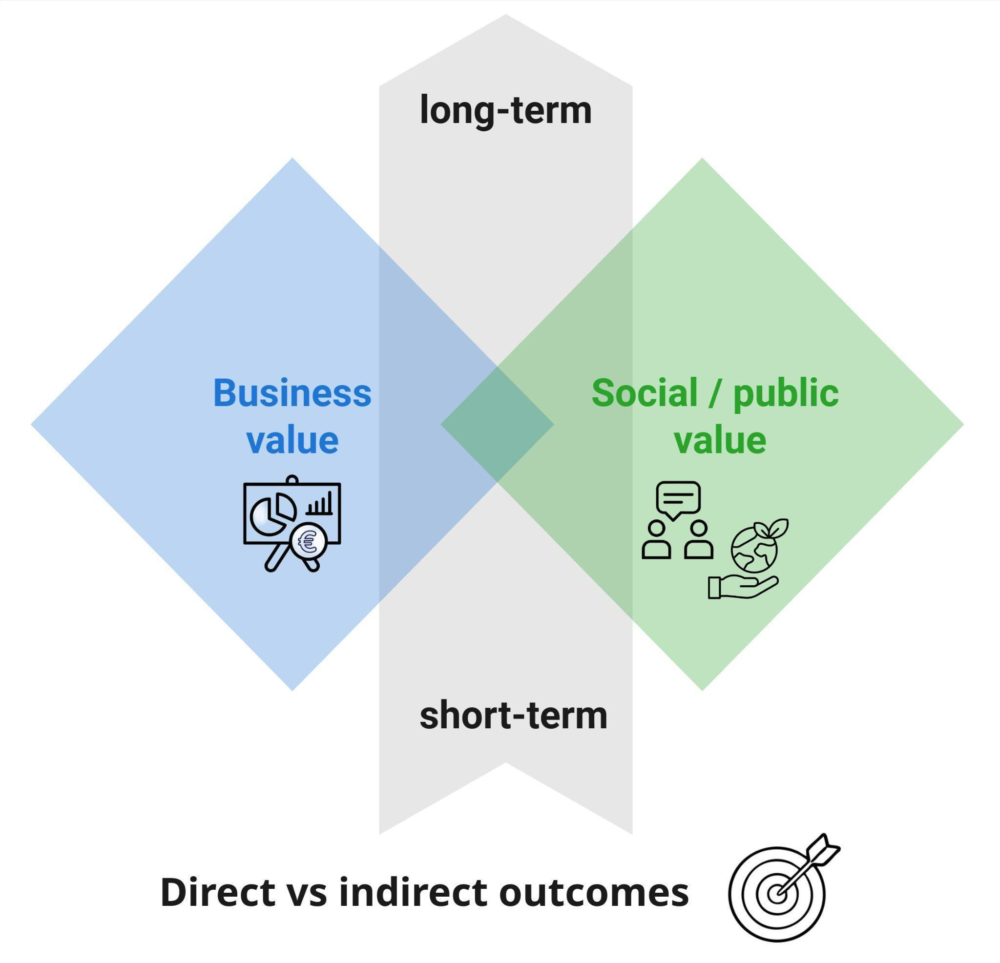
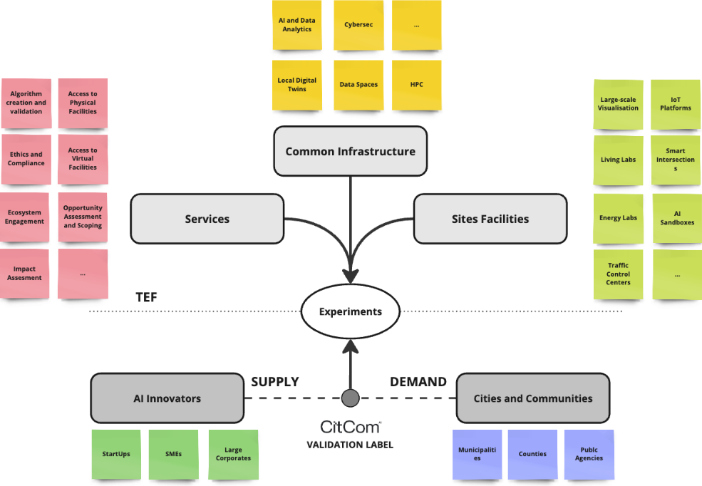

# Value creation & funding

A critical barrier to LDT sustainability is the **limited articulation of the value LDTs
generate**. Without clear value propositions and mechanisms to capture value across
stakeholders, long-term sustainability stays uncertain — and in public–private contexts,
value tends to stay opaque because stakeholders approach it from different perspectives.

This page sets out how value is created and captured in smart communities, and the funding
models available to sustain open-source LDT initiatives.

---

## Dimensions of value creation

Smart community literature consistently treats value creation as **multi-dimensional and
ecosystem-based** — involving economic, social, environmental and governance outcomes rather
than single-sector or single-actor gains. This aligns with the [**triple bottom line**](https://online.hbs.edu/blog/post/what-is-the-triple-bottom-line): people,
planet, profit.

One key distinction runs through the whole strategy.

-   :material-briefcase-outline:{ .lg .middle } __Business (private) value__

    Market creation, innovation, efficiency gains and revenue capture — often enabled by
    digital platforms, open data and new service models.

    Emphasises **tangible returns for firms or investors**: profits, reduced costs, new products
    or services. Service providers and utilities can monetise data or services and build new
    business opportunities by participating in data ecosystems.

-   :material-account-group-outline:{ .lg .middle } __Public (social) value__

    Rooted in public administration theory, focusing on **collective benefits**: quality of
    life, equity, sustainability, democratic participation and the legitimacy of governance.

    Encompasses economic prosperity as experienced by the community, plus outcomes like social
    cohesion, improved services and reduced social problems.

Stakeholders operate across several value dimensions at once — business and public value,
short- and long-term, direct and indirect outcomes. The strategy asks them to align these
rather than optimise for one.

{ width="70%" }

!!! info "Business and public value are interrelated"
    A smart street-lighting network may yield citywide energy savings (business value for the
    operator) *and* improved public safety and lower emissions (public value). Stakeholders
    operate across multiple value dimensions simultaneously, and the strategy calls on them to
    **align these dimensions rather than optimise for a single outcome**.

---

## Value capture

Value capture is *"the process of securing financial or non-financial returns from value
creation"* — addressing how benefits are recognised and who benefits.

- In **business value** contexts: who can monetise, and through which mechanisms.
- In **public value** contexts: how societal benefits are articulated through justifiable
  metrics, and reinvested into broader policy goals.

For LDT ecosystems this is particularly complex, because **benefits created and costs incurred
are not always equally distributed** — especially across different time scales or value
dimensions. Without appropriate capture mechanisms, stakeholders lack incentives to keep
contributing.

!!! warning "The central sustainability challenge"
    A successful ecosystem aligns **individual incentives with collective outcomes**, balancing
    cooperation (value creation) against competition (value capture). Diversified funding models
    require a clear understanding of how costs and benefits distribute across stakeholders, in
    order to address misaligned incentives.

**Collective benefits of ecosystem-based collaboration**, per [Data Spaces Support Centre](https://dssc.eu/space/SK/812056617/4+-+Business)
guidance:

| Benefit | Effect |
|---|---|
| **Efficiency gains** | Reduced economic transaction costs through standardised interfaces and lower integration effort, especially across sectors |
| **Improved collaboration** | Easier collaboration between data providers and consumers, improving interoperability |
| **Sovereignty & control** | Owners retain control over access and usage conditions, enhancing trust and avoiding lock-in |

**Opportunities specific data-sharing use cases open up:**

- **Cost sharing** — participants share data to meet shared requirements (compliance, process
  efficiency, transparency), so every member saves money and time.
- **Joint innovation** — innovation only realisable by ecosystem members working together,
  where no single member holds all the necessary data or resources.
- **Combined forces** — members team up to prevent a small number of dominant market players
  from emerging.

In practice, authorities may set up contracts with performance-based clauses (investment in
exchange for service delivery guarantees), or establish **shared governance boards and joint
living labs** to co-design solutions with public agencies, businesses and citizens.

---

## Funding models for open-source initiatives

LDT4SSC recommends deploying **open-source software** — it helps integrate heterogeneous data
sources, supports interoperable platforms, and enables continuous collaboration. Municipalities
are more likely to avoid vendor lock-in and keep components adaptable.

!!! info "No single optimal model"
    Successful strategies typically combine **multiple funding mechanisms** — blended funding
    such as public–private partnerships, or research grants plus sponsorship — with matching
    governance arrangements. The key is matching the model to the local context.

| Model | Features | Advantages | Drawbacks | Fit for communities |
|---|---|---|---|---|
| **Government-led public funding** | Developed or maintained by government grants or budgets | Stable, large-scale funding; aligns with public interest; no licence fees | Subject to political cycles and budget cuts; may underfund community-building | Ideal for core digital infrastructure. Best for large cities or consortia that can tap national/EU funds |
| **Municipal consortium / co-funding** | Multiple cities pool resources via consortia or inter-municipal agreements | Cost-sharing; economies of scale; peer support | Coordination overhead; slow consensus; risk of free-riders | Works when cities face similar needs. *Examples: Signalen (NL), eVaka (FI)* |
| **Service contracts / paid support** | Companies or consultants hired to develop or maintain | Professional support ensures reliability; suppliers assume some cost | Can introduce lock-in to the service provider | Common where in-house dev staff is lacking. **Contracts must require code release** |
| **Nonprofit foundations / trusts** | An independent entity hosts the project | Neutral governance; stable brand; can receive donations and grants | Foundation overhead; needs ongoing funding and engagement | Suitable for large cross-jurisdiction projects |
| **Platform cooperatives** | Multi-stakeholder co-op owns the project, users as members | Democratic governance; aligns incentives of users and maintainers | Organisational complexity; relies on members' willingness; still nascent | Good for communities of practice. *Example: [LocalGov Drupal](https://localgovdrupal.org/) (UK)* |
| **Volunteer / community-driven** | Relies on unpaid contributions | Low direct cost; fosters civic engagement | High burnout risk; uneven support | Small-scale or experimental projects. **Fragile alone** — should be augmented |
| **Hybrid models** | Any mix of the above | Diversified risk; combines community trust with funding | More complex to manage; potential conflicts of interest | Often the most realistic for large initiatives |

!!! info "Open source as digital infrastructure"
    Communities should **budget for maintenance like any public good**, while fostering a
    community around it. This requires long-term investment, clear governance, and an ecosystem
    approach balancing public oversight with community participation.

    Known obstacles include outdated procurement laws, unclear licence rules and staff skill
    gaps — requiring **legal enablers** such as embedding open-licence requirements into
    tenders, and investment in building internal talent.

---

## Validation, certification & standardisation

Validation, certification and standardisation are interconnected enablers of trust, procurement
readiness and scalable uptake:

- **Standards** provide the criteria against which services are validated;
- **Validation** produces the evidence on which certification rests;
- **Certification** signals to procurers and regulators that a service meets recognised
  expectations.

Together they form a **valorisation strategy** — an investment that strengthens the market
position of services, the credibility of the private partners developing them, and the
procurement confidence of the authorities deploying them.

!!! info "Validation proportional to maturity and risk"
    Not all components or stages need the same rigour. Validation depth maps onto the
    [LDT4SSC Methodology](../resources_content/methodology.md) phases:

    | Phase | Validation focus |
    |---|---|
    | **EXPLORE** (Ideation) | Lighter: feasibility checks and architectural assumptions |
    | **VALIDATE** (Specifications) | Technical and functional requirements; data governance, interoperability, legal constraints |
    | **DEFINE** (Prototyping) | Concrete solutions tested with real data and representative users |
    | **IMPLEMENT** (Deployment) | Governance robustness, explainability and regulatory compliance |

    [**ISO/IEC 30186:2025**](https://www.iso.org/standard/53308.html) (Digital Twin maturity model) reinforces this staged logic with
    internationally recognised assessment indicators.

**The standardisation landscape.** LDT services sit at the intersection of several streams:
[**ISO/IEC JTC 1/SC 41**](https://www.iso.org/committee/6483279.html) for core digital-twin standards; **ETSI ISG CIM** for [NGSI-LD](https://ngsi-ld.org/), with
[Smart Data Models](https://smartdatamodels.org/) forming the semantic interoperability base; [**OGC**](https://www.ogc.org/standards/) and [**ISO/TC 211**](https://www.iso.org/committee/54904.html) for
geospatial and 3D layers ([CityGML](https://www.ogc.org/standards/citygml/), [SensorThings API](https://www.ogc.org/standards/sensorthings/), [3D Tiles](https://www.ogc.org/standards/3dtiles/)), with [buildingSMART's IFC 4.3](https://ifc43-docs.standards.buildingsmart.org/)
bridging BIM; **IDSA** and the [Eclipse Dataspace Protocol](https://eclipse-dataspace-protocol-base.github.io/DataspaceProtocol/2025-1/) for trusted data exchange. At European
level, [**CEN-CENELEC JTC 21**](https://jtc21.eu/) produces harmonised [AI Act](https://eur-lex.europa.eu/eli/reg/2024/1689/oj/eng) standards, while **CEN/TC 465** is the
most plausible home for elevating LDT4SSC outputs into European standardisation.

**[Testing and Experimentation Facilities](https://digital-strategy.ec.europa.eu/en/policies/testing-and-experimentation-facilities) (TEFs).** Under the Digital Europe Programme, [TEFs](https://digital-strategy.ec.europa.eu/en/policies/testing-and-experimentation-facilities) are
large-scale reference environments for testing AI-enabled technologies in realistic settings.
They generate structured validation artefacts — performance benchmarks, interoperability logs,
scenario evaluations — reusable in certification submissions and procurement evaluations.

!!! info "[CitCom.ai](https://citcomtef.eu/) — the TEF for cities and communities"
    Of the four sectoral TEFs, [**CitCom.ai**](https://citcomtef.eu/) focuses on trustworthy AI services for cities,
    communities and citizens. Co-funded by the Digital Europe Programme and Member States
    (€40 million, 2023–2027), it runs **15 experimentation sites across 10 European countries**
    in three thematic super-nodes:

    - **POWER** — energy (Denmark, Sweden, Finland)
    - **MOVE** — mobility (Belgium, Netherlands, France, Luxembourg)
    - **CONNECT** — cross-sector citizen-facing infrastructure (Spain, Italy, Poland)

    Services span application creation and validation, community engagement, compliance and
    ethics assistance, physical and virtual facility access, and scope definition — catalogued
    in the [CitCom.ai services marketplace](https://citcomtef.eu/services/).

{ width="92%" }

[:octicons-arrow-left-24: Ecosystem diagnostics](diagnostics.md){ .md-button }
[:octicons-arrow-right-24: Strategic priorities](priorities.md){ .md-button .md-button--primary }
